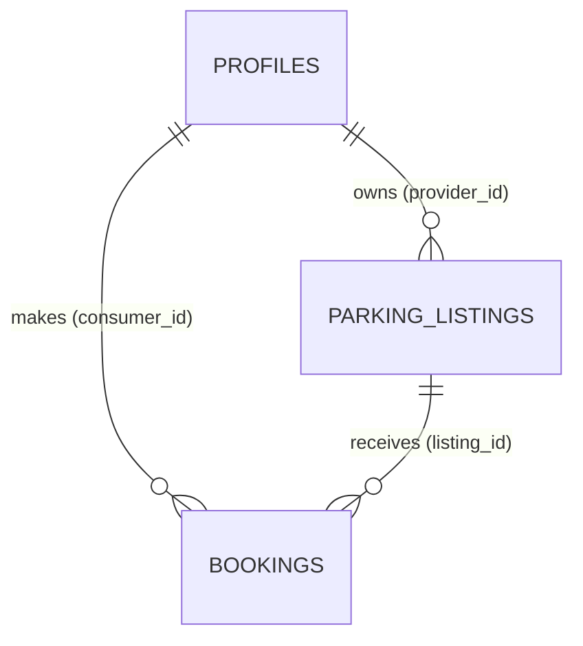

# ParkMate Database Schema (v1)

Database: **PostgreSQL on Supabase**. Runnable SQL is in [`schema.sql`](./schema.sql).
Owner: Backend & Database Lead. Tell the owner before changing anything here.

## How the tables connect

- **One account does both jobs.** Someone who owns listings acts as a provider; someone who has bookings acts as a consumer. There is no role column.
- A **profile** is created automatically when a user signs up (linked to Supabase Auth).

## Tables

### `profiles`
| Column | Type | Notes |
|---|---|---|
| id | uuid, PK | Same id as the Supabase Auth user |
| display_name | text, required | Shown to providers on bookings |
| is_admin | boolean, default false | Marks reviewers. Can only be changed by the backend/DB owner |
| created_at | timestamptz | Auto |

### `parking_listings`
| Column | Type | Notes |
|---|---|---|
| id | uuid, PK | Auto |
| provider_id | uuid, required | FK → profiles.id |
| title | text, required | |
| address | text, required | Human-readable |
| latitude, longitude | numeric(9,6), required | Needed for distance search/ranking |
| price_per_hour | numeric(8,2), must be > 0 | INR |
| is_active | boolean, default true | Provider can pause a listing |
| status | `pending` / `approved` / `rejected` | Default `pending`. Only an admin can change it |
| created_at, updated_at | timestamptz | Auto |

### `bookings`
| Column | Type | Notes |
|---|---|---|
| id | uuid, PK | Auto |
| listing_id | uuid, required | FK → parking_listings.id |
| consumer_id | uuid, required | FK → profiles.id |
| start_time, end_time | timestamptz, required | Stored in UTC. `end_time` must be after `start_time` |
| total_price | numeric(10,2) | Calculated by the database at booking time (price × hours) and then frozen |
| status | `confirmed` / `cancelled` | Default `confirmed` |
| created_at | timestamptz | Auto |

## Rules and where they are enforced

| Rule | Enforced by |
|---|---|
| Each listing belongs to one provider | Foreign key `provider_id` |
| Each booking belongs to one consumer and one listing | Foreign keys |
| Only approved, active listings can be booked | Database trigger on `bookings` (error `LISTING_NOT_BOOKABLE`) |
| **No overlapping bookings, even when two people book at the same instant** | Database **exclusion constraint** on (listing, time range). Postgres rejects the second insert, so no race condition is possible |
| Back-to-back is allowed (10:00-11:00 then 11:00-12:00) | Time range is start-inclusive, end-exclusive |
| Cancelled bookings free the slot | The constraint only applies to `confirmed` bookings |

## Security (who can do what)

Two layers: the **backend checks permissions in code**, and **Row Level Security (RLS)** in the database is a safety net.

| Table | Who can read | Who can write |
|---|---|---|
| profiles | Only yourself | You can change only your own `display_name` |
| parking_listings | Everyone sees approved + active listings. Providers also see their own (any status) | Providers create (always as `pending`) and edit only their own, and cannot touch `status`. Approve/reject is backend-only, admin-checked |
| bookings | The consumer who made it, and the provider who owns the listing | Consumers create their own bookings. Changes after that (e.g. cancel) go through the backend |

**Important for backend devs:**
- The Supabase **service-role key bypasses RLS**. Keep it on the server only, never in the frontend or in GitHub. Because of this, every Express route must check permissions itself (verify the login token, then check ownership or `is_admin`).
- Never trust `provider_id` or `consumer_id` sent from the frontend. Always take them from the logged-in user.

## Decisions made (speak up if you disagree)

1. **One listing = one parking space.** The draft's `availability` field is replaced by: a listing is free for a time window if no confirmed booking overlaps it (plus `is_active` to pause it).
2. **Bookings confirm instantly.** No provider approval step.
3. **Added to the draft:** `latitude`/`longitude` (distance ranking), `total_price` (so later price changes don't alter old bookings), `is_admin` (reviewers), `is_active`, `created_at`.
4. The draft's `address or location` became `address` + `latitude` + `longitude`.
5. Times are stored in UTC; the frontend converts to local time.
